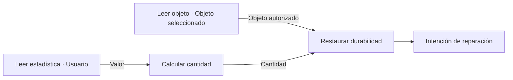

# Reparar durabilidad por micromódulos — fase inicial

## Mecánica común

**REPAIR_DURABILITY no pertenece a una habilidad concreta.** La misma operación podrá ser usada por habilidades de herrero, un objeto autorreparable o un servicio del sistema cuando exista un adaptador de activación/persistencia autorizado. No es una curación de HP ni una sustitución de la estadística de defensa.

Esquema de conexiones real del constructor React Flow:

**Puertos y semántica**:
- `READ_ITEM(selector,output)`: salida tipada **ITEM**. El selector puede elegir `OWNER_MAIN_HAND`, `OWNER_OFFHAND`, `SELECTED_ITEM` o `SOURCE_ITEM`. La identidad numérica `characterItemId` no se extrae de una fórmula ni del nombre del objeto; procede exclusivamente de los enlaces del contexto **que construya el servidor**.
- `REPAIR_DURABILITY(target,amount)`: `target={source:"OUTPUT",key:"..."}` apunta a un `READ_ITEM` anterior y `amount` acepta un número, `READ_STAT`, `READ_STORED`, `CONSUME`, `CALCULATE`, una salida numérica anterior o una fórmula aritmética compuesta. Una salida ITEM no puede alimentar una operación numérica ni viceversa.
- La cantidad solicitada debe ser finita, no negativa, hasta 1.000.000. La durabilidad son puntos **enteros 0–100**; las fracciones se redondean hacia abajo y se aplica `min(floor(cantidad), 100-durabilidadActual)`. Cero o ya estar al máximo produce reparación 0. No afecta a HP/mana ni multiplica por `quantity`.
- Durante un evento, varios pasos de reparación del mismo objeto se calculan secuencialmente sobre un estado temporal para que no sobrepasen el máximo.
- El evaluador produce **intenciones sin efectos secundarios** con el ID de ejemplar, `before`, `after`, `requested` y `applied`. No modifica la base de datos.
- `ACTIVATE`, `IMPACT` y `TURN_START` se pueden deduplicar por `eventId`; la evaluación `PASSIVE` no equivale a una autorización de reparación persistente.

## Ejemplos de diseño (todavía sin conexión autorizada al inventario persistente)

### Herrería

`READ_ITEM SELECTED_ITEM → objetoElegido`; `READ_STAT USER magicDefense → poder`; `CALCULATE poder * 0,6 → cantidad`; `REPAIR_DURABILITY(objetoElegido,cantidad)`. El atributo y coeficiente son solo un **ejemplo de composición**, no valores definitivos de balance o costes PCH. Una habilidad real deberá conservar su propia aprobación, requisitos, maná, rango y costes de acción.

### Autorreparación

`READ_ITEM SOURCE_ITEM → objetoPortador`; `CALCULATE 5 → cantidad`; `REPAIR_DURABILITY(objetoPortador,cantidad)` con un disparador programado, por ejemplo `TURN_START`. No debe activarse por renderizar el inventario o leer la ficha. Requiere reglas aprobadas de frecuencia, duración, recurso, cooldown y persistencia antes de incorporarse a objetos reales.

### Servicio de reparación y forja

El servicio validará una tarifa/regla establecida, condiciones del taller, cliente propietario y disponibilidad del ejemplar; luego invocará el **mismo grafo** con `SELECTED_ITEM` y registrará el cobro y el cambio en **una sola transacción**, usando el `characterItemId` autorizado. Repeticiones de solicitud se deduplicarán; las actualizaciones concurrentes deben operar sobre la durabilidad *actual* de la fila y no sobre el `before` de la evaluación inicial. Forjar/fabricar objetos involucra recetas, materiales y resultados independientes; reparar será una suboperación del taller, no una forma de crear objetos gratis.

## Estado preciso tras esta PR

**Incluye:** nuevo contrato de micromódulos, validación estricta de puertos, ejecución determinista sin efectos secundarios, salida de intención, evento ACTIVATE, nombres en español, conexión React Flow, atajo del constructor, tests e integración con cotización provisional de PCH (lector de objeto no cobra, acción de reparación sí).

**No incluye:** ejecutar el efecto modular aprobado de forma automática desde una habilidad de personaje, cobrar por reparación, servicios de taller, forjar materiales nuevos, reparar objetos en la base de datos o otorgar regeneración gratis al equipamiento. Estas etapas requieren conectores de autorización, disparadores y actualización transaccional específicos. No hay migración SQL en esta PR.

Así se pueden reutilizar la geometría y las fórmulas sin duplicar una lógica de reparación por habilidad, objeto o tienda.
