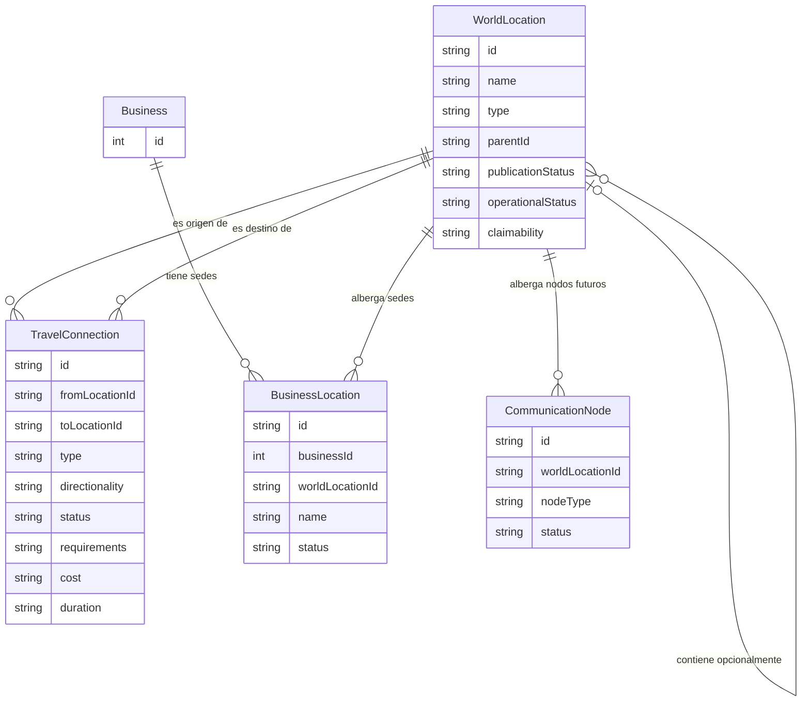

# Xahya: arquitectura del mundo compartido y simulación

**Estado:** propuesta inicial; no implementada.  
**Objetivo:** conservar la visión del mundo y establecer una ruta técnica para añadir geografía, economía local, población agregada, transporte, seguidores y reinos sin rehacer los sistemas existentes.

## Decisiones acordadas

- Xahya tendrá un único mundo compartido por todos los jugadores.
- El mundo puede contener continentes, islas, archipiélagos e islas flotantes.
- La administración prepara los territorios y ciudades disponibles. Los jugadores pueden reclamar cualquier territorio marcado como libre y reclamable, pero no inventar mapas o territorios inexistentes.
- Una locación puede existir sin ciudad, habitantes, edificios ni detalle visual.
- El mapa general puede mostrar solo ciudades; el detalle de barrios, edificios y puntos de interés se muestra cuando exista y sea útil.
- Las islas flotantes pertenecen al mismo mundo y pueden requerir vuelo, monturas, magia, portales u otros medios configurables para acceder.
- Aurora son negocios existentes, no el nombre genérico de la tecnología. Las sedes de Santuario Aurora y El Gran Refugio Aurora pertenecen actualmente a Guha Arisel y deben poder estar en locaciones distintas, incluso en continentes diferentes o con una sede en una isla flotante.
- Un negocio que alcance el nivel de tecnología de teletransporte puede proponer una conexión con otro negocio; la conexión solo se activa si ambos propietarios la autorizan.
- Red Nova Link es un negocio existente y el equivalente al internet de Xahya: una red global de comunicación e información que incluye torres y satélites. Puede ofrecer acceso público mediante dispositivos compatibles y acceso mediante contratos con el negocio; ambos modelos deben poder coexistir. La cobertura de Red Nova no implica capacidad de teletransporte ni una ruta física.
- La población general se representa principalmente con cohortes estadísticas, no con una fila por habitante. Los NPC que necesiten identidad e historia propias pueden individualizarse.
- Los jugadores podrán reunir seguidores individuales y cohortes, fundar asentamientos y, si cumplen las reglas del juego, formar reinos.
- Las tiendas pueden tener catálogos, existencias y precios diferentes según su negocio y ubicación.
- El esquema actual ya contempla planes de suscripción y suscripciones de personajes a servicios de negocios (`BusinessSubscriptionPlan` y `BusinessSubscription`); antes de añadir servicios de Red Nova, se debe reutilizar y auditar este flujo en vez de crear una segunda suscripción equivalente.
- Los contratos con gobiernos o instituciones deben poder representarse como acuerdos comerciales/institucionales distintos de una suscripción individual recurrente, aunque puedan compartir conceptos como servicio, vigencia, precio, estado y condiciones.
- La simulación avanza por ciclos y guarda su estado; no recalcula el mundo entero cada vez que alguien abre una pantalla.

## Principios de arquitectura

### 1. Geografía jerárquica y detalle opcional

La jerarquía conceptual puede ser: mundo → continente o masa territorial → región → ciudad → barrio → edificio → punto de interés. No es obligatorio crear todas las capas. Una isla puede ser una región reclamable; una ciudad puede existir sin barrios; una mazmorra puede ser un punto de interés dentro de una región.

Cada locación podrá definir, según su tipo:
- locación padre e hijas;
- tipo: continente, isla, isla flotante, región, ciudad, barrio, edificio o punto de interés;
- estado de publicación/exploración;
- propiedades geográficas y recursos;
- capacidad o reglas de asentamiento;
- conexiones de viaje y requisitos de acceso;
- si es reclamable y bajo qué condiciones.

Las coordenadas, el mapa visual y el editor de mapas pueden llegar después. La primera versión no necesita simulación física ni un mapa visual completo.

### 2. Geografía, reclamaciones, asentamientos y reinos son entidades diferentes

- **Locación/territorio:** existe en el mundo y lo prepara la administración.
- **Reclamación territorial:** indica quién controla o reservó un territorio, su estado e historial.
- **Asentamiento:** población y estructuras que existen dentro de un territorio.
- **Reino/facción:** organización política que puede controlar varios territorios y asentamientos.
- **Propiedad privada:** negocio o edificio que puede pertenecer a un personaje sin convertirlo en soberano del territorio.

Las reclamaciones se validan en el servidor y se resuelven transaccionalmente para impedir que dos jugadores reclamen a la vez el mismo territorio. Se deberán definir fronteras, expansión a territorios vecinos, abandono, disolución de reinos y zonas reservadas para la historia.

### 3. Viajes y acceso

La geografía y las rutas se modelan por separado. Las conexiones pueden ser terrestres, marítimas, aéreas, mágicas o portales/teletransportación. Cada conexión puede definir origen, destino, estado, coste opcional y requisitos.

El vuelo y la magia deben ser requisitos configurables, no excepciones codificadas exclusivamente para islas flotantes. Los negocios son establecimientos físicos; sus conexiones de transporte se modelan aparte de sus ubicaciones. Cada sede conserva su propia economía.

#### Terminología sánscrita propuesta

Estos nombres son etiquetas de diseño pendientes de validación; no son sistemas implementados ni cambian los nombres comerciales actuales:

- **Dvāra (द्वार, «puerta»):** tecnología/capacidad de teletransporte que un negocio puede adquirir y mejorar por nivel. No es un negocio independiente ni reemplaza nombres como Aurora o Red Nova Link.
- **Setu (सेतु, «puente»):** conexión de teletransporte autorizada entre dos extremos compatibles. Cada extremo pertenece a una sede física y mantiene su identidad, inventario, empleados, precios y economía.
- **Mahāsetu (महासेतु, «gran puente»):** nombre conceptual reservado para una posible infraestructura distribuida de transporte físico con múltiples nodos y rutas. No representa Red Nova Link ni su red de internet; solo se usaría si Xahya incorpora una infraestructura de transporte de ese tipo.

#### Reglas de una conexión Dvāra/Setu

1. La capacidad Dvāra pertenece al negocio y tiene un nivel propio; no se confunde con el nivel del personaje propietario ni con el nivel general del negocio.
2. Un negocio con el nivel requerido puede solicitar conectar una sede con otra sede compatible.
3. La conexión queda pendiente hasta que los propietarios de ambos negocios la autoricen. La autorización debe registrarse por cada extremo; no basta con que un único propietario controle ambos negocios.
4. La conexión puede activarse, suspenderse o revocarse según las reglas que se definan. El estado y las autorizaciones deben persistir y validarse en el servidor.
5. La ubicación física nunca se falsifica: una sede en un continente y otra en una isla flotante siguen siendo locaciones distintas aunque estén conectadas instantáneamente.
6. Una conexión entre dos sedes no implica que todo el negocio comparta inventarios o precios, ni concede acceso automático a otras sedes.
7. Si en el futuro existe una infraestructura de transporte Mahāsetu, podrá tener múltiples nodos y rutas, con requisitos y permisos propios. Debe modelarse por separado de la red de comunicación Red Nova Link y no como una lista de enlaces bilaterales Aurora.

#### Casos de referencia actuales

- **Santuario Aurora** y **El Gran Refugio Aurora** pertenecen actualmente a **Guha Arisel**. Pueden ubicarse en continentes diferentes; una de las locaciones podría ser una isla flotante. Aunque hoy compartan propietario, sus ubicaciones y economías siguen separadas. La regla de autorización de ambos extremos se conserva para permitir que, en el futuro, se conecten negocios de propietarios distintos.
- **Red Nova Link** también pertenece actualmente a **Guha Arisel** y se concibe como el internet de Xahya, con torres repartidas por el mundo y satélites. Su modelo debe representar nodos de comunicación, cobertura, capacidad y acceso. Puede haber acceso público con dispositivos compatibles y acceso mediante contratos comerciales; la coexistencia y las condiciones exactas de ambos modelos quedan por definir. Tener cobertura Red Nova no concede acceso a portales ni permite teletransportarse.

### 4. Población agregada y NPC individualizados

Una cohorte representa un número de habitantes con características compartidas o distribuciones estadísticas; no es un personaje jugable. Puede contener:
- locación o asentamiento;
- cantidad de habitantes;
- raza, cultura u otros grupos demográficos cuando aplique;
- distribuciones/probabilidades de estadísticas y afinidades;
- ocupaciones y especialización;
- necesidades, productividad y situación económica;
- parámetros de nacimientos, muertes y migración;
- fecha o versión del último ciclo simulado.

Las distribuciones deben ser compactas y validables. No crear una fila por persona para representar la población general.

**Individualización:** si un habitante necesita nombre, relaciones, inventario, decisiones o historia persistente, se crea un NPC individual y se descuenta de su cohorte de origen en una operación atómica. Así no se cuenta dos veces a la misma población. La muerte, migración o reintegración de NPC debe mantener las cantidades consistentes.

Los nombres y descripciones genéricos viven en catálogos compartidos. Las identidades personales permanecen en registros individuales. Un ID sustituye datos repetidos de catálogo, no el nombre propio de una persona.

### 5. Seguidores y reinos

Distinguir:
- **NPC seguidor individual:** persona con identidad e historial asociada a un jugador/personaje.
- **Cohorte de seguidores:** grupo de colonos, trabajadores, población o fuerzas que representa muchas personas.
- **Población territorial:** habitantes de un asentamiento o reino, que no necesariamente son seguidores personales del gobernante.

Un jugador puede reunir seguidores, trasladar cohortes, fundar asentamientos y eventualmente crear un reino. Lealtad personal, residencia, empleo y soberanía son relaciones distintas: trabajar para un jugador no convierte automáticamente a un habitante en seguidor suyo.

Cuando una cohorte se establece en una locación, la población se transfiere entre grupos/localizaciones sin duplicarla. Las reglas de creación de reinos, costes, requisitos y gobierno se definirán en una fase posterior.

### 6. Economía local y comercios

Separar el catálogo compartido de bienes de la disponibilidad y precios locales. Conceptos:
- tipo de recurso/producto;
- inventario local por ciudad, asentamiento o negocio;
- reglas de producción: recursos consumidos y productos generados;
- demanda/consumo estimados de población y actividades;
- precio local, calculado o configurado con base en precio base, oferta, demanda, transporte, impuestos y modificadores;
- negocio con sede, empleados, inventario y reglas propias.

Las tiendas pueden vender catálogos distintos y aplicar precios diferentes por ubicación. No duplicar nombre y descripción del artículo en cada tienda: referenciar el catálogo y guardar localmente stock y valores comerciales variables. El precio base de un artículo no equivale al precio de venta local.

El esquema actual ya incluye Business y BusinessProduct, con existencias y precios de compra/venta por negocio. Antes de añadir tablas, evaluar cómo asociar negocios a locaciones y extender el mercado sin romper tiendas ni economía existentes.

### 7. Ciclos de simulación

La simulación se ejecuta por ciclos diarios, mensuales u otro calendario configurable, nunca en cada carga de pantalla. Un ciclo puede procesar:
1. producción y consumo de recursos;
2. inventarios, oferta, demanda y precios;
3. empleo e ingresos;
4. nacimientos, muertes y migración;
5. crecimiento o contracción de asentamientos;
6. acontecimientos y consecuencias políticas;
7. registro del resultado y avance del ciclo.

Requisitos:
- idempotencia: repetir un ciclo no duplica pagos, nacimientos ni producción;
- guardar último ciclo aplicado y versión de reglas;
- registrar eventos importantes y facilitar auditoría;
- procesar solo regiones activas cuando sea seguro;
- probar límites para evitar crecimiento descontrolado;
- hacer reproducible la aleatoriedad cuando sea necesario depurar.

No conservar solo las cohortes más exitosas: eso reduciría la diversidad y podría extinguir grupos artificialmente. Considerar azar, migración, ambiente y diversidad.

## Modelo lógico inicial (nombres orientativos)

Son conceptos de diseño, no nombres finales ni tablas creadas:

| Concepto | Responsabilidad |
|---|---|
| WorldLocation | Jerarquía de continentes, islas, regiones, ciudades y puntos de interés |
| TravelConnection | Rutas y conexiones, incluidos vuelo, magia y teletransportación |
| TerritoryClaim | Reclamación/control territorial e historial |
| Settlement | Asentamiento dentro de una locación |
| PopulationCohort | Cantidad de habitantes y distribuciones |
| Npc | Habitante individual persistente |
| CohortTransfer | Movimientos de población sin duplicación |
| ResourceType | Catálogo compartido de recursos y bienes |
| LocationInventory | Existencias locales |
| ProductionRule | Entradas, salidas y requisitos de producción |
| LocalMarketRule / LocalPrice | Oferta, demanda y precios locales |
| SimulationRun / SimulationState | Ciclos, estado, versión de reglas e idempotencia |
| WorldEvent | Acontecimientos persistentes |
| FollowerGroup | Cohortes bajo seguimiento o autoridad de un personaje |
| Kingdom / Faction | Organización política |
| KingdomTerritory | Relación entre reinos y territorios |
| BusinessLocation | Relación entre un negocio y cada una de sus sedes físicas; permite que un negocio tenga varias ubicaciones o torres |
| BusinessCapability | Capacidad tecnológica que posee un negocio y su nivel, por ejemplo Dvāra |
| ServiceAgreement / InstitutionalContract | Acuerdo comercial con una institución o gobierno; propuesta futura, distinta de una suscripción individual |
| BusinessSubscriptionPlan / BusinessSubscription | Modelos existentes en Prisma para planes de suscripción de negocios y suscripciones de personajes; auditar y reutilizar antes de extender servicios |
| TeleportLink / Setu | Conexión entre dos sedes con autorización registrada de ambos extremos |
| CommunicationNode / RedNovaNetwork | Torres, satélites, cobertura, capacidad y acceso a la red global de comunicación equivalente al internet |
| TeleportNode / MahāsetuNetwork | Nodos y rutas de una posible infraestructura distribuida de transporte físico, independiente de Red Nova Link |

No crear todas estas tablas de una vez. El esquema definitivo debe respetar las convenciones actuales de Prisma, las relaciones, los tipos de fecha y las claves de Xahya.

## Auditoría técnica preliminar del sistema existente

Esta revisión es estática del contrato Prisma y de las rutas de negocio/cobro en el repositorio; no modifica datos ni ejecuta pagos. Antes de diseñar migraciones, estos son los hallazgos útiles:

### Lo que ya existe y conviene reutilizar

- `Business` representa la entidad comercial y contiene propietario, caja, ingresos pasivos, inversiones y estado activo.
- `BusinessProduct` ya guarda catálogo por negocio, existencias y precios de compra/venta independientes; no hace falta duplicar el catálogo de artículos para cada locación.
- `BusinessSubscriptionPlan` define planes de suscripción propiedad de un negocio. `BusinessSubscription` enlaza el plan con un personaje, guarda si está activa y cuándo corresponde el siguiente cobro.
- `app/api/businesses/subscribe/route.ts` valida la propiedad del personaje, comprueba saldo y, dentro de una transacción, cobra la primera cuota y abona la caja del negocio.
- `lib/economy.ts` procesa cobros recurrentes desde el cron de economía. Si el personaje no tiene fondos suficientes, la suscripción actual se desactiva.
- `EconomyPaymentLog` tiene una clave única para evitar duplicar ciertos pagos por periodo. Sin embargo, los cobros de suscripción no crean actualmente una fila en ese registro; su avance depende de actualizar `lastChargedAt` y `nextChargeAt`.

### Límites que el nuevo diseño debe resolver

1. **No existe una entidad geográfica asociada a Business.** No hay una relación que diga dónde está una sede física, y tampoco un modelo para múltiples sedes, torres o satélites de un mismo negocio.
2. **Las suscripciones actuales son individuales.** `BusinessSubscription` exige `characterId`; no representa directamente un contrato con gobierno, municipio u otra institución.
3. **La prevención de suscripciones duplicadas debe reforzarse.** El endpoint comprueba si ya hay una suscripción activa antes de crearla, pero el modelo no declara una restricción única que impida una duplicación concurrente del mismo personaje y plan.
4. **La idempotencia de cobros recurrentes merece una prueba específica.** Como el cobro de suscripción no registra una entrada en `EconomyPaymentLog`, se debe comprobar el comportamiento ante dos ejecuciones simultáneas del cron o reintentos antes de ampliar este sistema a servicios de Red Nova.
5. **El contrato institucional no debe fingir que un gobierno es un personaje.** Conviene modelar la contraparte institucional y el acuerdo por separado, reutilizando el motor de caja/cobros donde sea seguro, pero sin forzar `characterId` para un pagador no-personaje.

### Recomendación técnica resultante

- Mantener `Business` como entidad comercial, sin convertir cada torre, satélite o sucursal en un negocio distinto.
- Añadir en una fase futura `BusinessLocation` para cada sede o punto físico y asociarlo a `WorldLocation`; los nodos de comunicación de Red Nova deben distinguirse de las sedes comerciales ordinarias.
- Conservar `BusinessSubscriptionPlan` y `BusinessSubscription` para suscripciones de personajes. Antes de extenderlas, diseñar y probar un registro de cobro/idempotencia que permita auditar cada cuota.
- Modelar contratos institucionales como acuerdos con contraparte, alcance geográfico, servicio contratado, precio, vigencia, estado, condiciones de renovación y registro de pagos. Los detalles de gobierno, impuestos, penalizaciones y contratación quedan abiertos.
- No añadir todavía las tablas anteriores a producción. Primero cerrar el modelo lógico y preparar una migración revisable, incluyendo las restricciones e índices necesarios.

## Modelo lógico propuesto: geografía, sedes y servicios

Este modelo es una propuesta de diseño para revisar antes de escribir migraciones. Los nombres de campos y enums son orientativos; se ajustarán a las convenciones reales de Prisma y a las reglas finales del juego.

### 1. Geografía y territorios

**WorldLocation** representa una unidad geográfica o un lugar preparado por administración.

Campos conceptuales:
- `id`: identificador estable.
- `parentId`: relación opcional con otra `WorldLocation`; permite jerarquías sin obligar a crear todos los niveles.
- `type`: tipo geográfico, inicialmente con opciones como `CONTINENT`, `REGION`, `CITY`, `ISLAND`, `ARCHIPELAGO`, `FLOATING_ISLAND`, `DISTRICT`, `BUILDING` y `POINT_OF_INTEREST`. La lista definitiva se validará antes de migrar.
- `name`, `description`: nombre y descripción.
- `status` o indicadores explícitos: preparado/publicado, activo y disponible para reclamación.
- `claimable`: si puede reclamarse; no sustituye la validación del estado ni de los requisitos.
- metadatos opcionales para orden de presentación, coordenadas, requisitos de acceso y propiedades específicas del tipo.

**Regla importante:** el tipo describe la geografía; el estado indica si está preparada/disponible. Una isla flotante no se considera automáticamente reclamable ni accesible. Los territorios que todavía no haya preparado administración no aparecen como opciones para reclamar. Las ubicaciones pueden existir sin mapa, barrios, edificios ni población.

**TerritoryClaim** debe ser una entidad separada, con territorio, titular (personaje o futura facción/reino), estado, fechas e historial. La reclamación activa se protege con transacción y una restricción que impida dos titulares activos incompatibles para el mismo territorio. Las reglas de quién puede reclamar y cómo se libera se definirán por separado.

### 2. Negocios y sedes físicas

**Business** continúa representando la empresa y su caja. **BusinessLocation** representa cada sede física, sin crear una empresa nueva por cada sucursal.

Campos conceptuales de `BusinessLocation`:
- `id`, `businessId`, `worldLocationId`;
- `name` y descripción opcional;
- `siteType` (por ejemplo sede, sucursal, tienda o instalación);
- estado activo/inactivo y metadatos específicos cuando hagan falta.

Una sede pertenece a un negocio y se asocia a una locación del mundo. Un negocio puede tener varias sedes; no se debe suponer que la sede principal comparte automáticamente inventario, personal, precios o caja con las demás. La primera migración no debe inventar dónde están actualmente Red Nova Link, Santuario Aurora o El Gran Refugio Aurora: sus ubicaciones se asignarán cuando se decidan explícitamente.

Los productos siguen usando el catálogo compartido `Item` y el inventario/precio local existente de `BusinessProduct` mientras ese diseño siga siendo suficiente. Si después se requiere inventario separado por sede dentro de un mismo negocio, se diseña esa extensión como una fase propia en lugar de cambiar silenciosamente la semántica actual.

### 3. Red Nova Link: comunicación, no transporte

La red de comunicación se modela separada de las sedes comerciales y de los portales.

**CommunicationNode** representa una torre, satélite u otro nodo técnico. Puede relacionarse con una `BusinessLocation` cuando esté instalado en una sede; los satélites u otros nodos no terrestres no deben forzarse a tener una sede urbana. Campos conceptuales:
- `id`, `businessId` y relación opcional con `BusinessLocation` o con una ubicación/orbita compatible;
- `nodeType` (por ejemplo torre, satélite o estación);
- estado, capacidad y parámetros de cobertura;
- datos técnicos adicionales en columnas tipadas o una configuración validada, según las necesidades que se confirmen.

La cobertura y la capacidad son datos de red, no permisos de teletransporte. Un punto puede tener internet Red Nova sin portal, o portal sin cobertura Red Nova.

El acceso público y el acceso por contrato deben coexistir. La cobertura por sí sola no significa que todo dispositivo tenga acceso gratuito: la elegibilidad del dispositivo, condiciones de servicio, límites y cobertura efectiva se definirán como reglas del servicio. No crear todavía tarifas ni requisitos no acordados.

### 4. Dvāra y Setu: capacidad y enlace bilateral

**BusinessCapability** representa capacidades tecnológicas adquiridas por un negocio, con tipo y nivel. Dvāra sería una capacidad de teletransporte; no una empresa, una sede ni un enlace ya activo. Conviene que el modelo permita futuras capacidades sin añadir una tabla distinta por cada tecnología.

**TeleportLink / Setu** representa una conexión entre dos `BusinessLocation` compatibles. Campos conceptuales:
- identificador y dos extremos explícitos (`endpointAId`, `endpointBId`);
- estado de la solicitud y estado operativo;
- fechas de solicitud, aprobación, activación, suspensión o revocación;
- nivel/requisitos validados al solicitar y al activar, si las reglas necesitan conservar evidencia.

Las autorizaciones deben registrarse por extremo, no como un único booleano global. Cada extremo identifica el negocio/sede que consiente y la autorización de su propietario autorizado. Si una persona posee ambos negocios, se siguen registrando ambas aprobaciones explícitas. La activación requiere los dos consentimientos y la validación del nivel Dvāra y de la compatibilidad. El servidor verifica permisos y estados; el cliente no puede activar ni aprobar el enlace por sí solo.

No se debe permitir que un enlace convierta dos sedes en una sola ubicación ni que comparta automáticamente sus economías. Mahāsetu permanece fuera de esta primera versión; solo se modelará si se aprueba una infraestructura de transporte distribuida con rutas y nodos propios.

### 5. Acceso por suscripción y contratos institucionales

Se conserva el flujo actual:
- **BusinessSubscriptionPlan**: plan ofrecido por un negocio.
- **BusinessSubscription**: suscripción de un personaje a un plan.

Antes de extenderlo a Red Nova, se debe reforzar la integridad de suscripciones duplicadas y probar los cobros recurrentes con ejecuciones concurrentes/reintentos. Cada cuota debería poder auditarse con una clave idempotente estable que identifique la suscripción y el periodo facturado. La implementación concreta debe comprobarse contra el esquema y el motor de economía antes de definir la restricción final; no añadir una unicidad que impida renovaciones legítimas.

**ServiceAgreement / InstitutionalContract** representa un contrato entre un negocio proveedor y una contraparte institucional (por ejemplo un gobierno, municipio o institución), que no tiene por qué ser un `Character`. Debe contemplar:
- proveedor y contraparte institucional;
- servicio contratado y alcance geográfico opcional;
- precio, moneda/recurso de pago y periodicidad o vigencia;
- estado, fechas de inicio/fin y condiciones de renovación;
- referencia a términos aceptados y a los pagos del contrato.

La contraparte institucional debe tener identidad propia, aunque su estructura de gobierno y sus representantes se definan más adelante. No se debe simular un gobierno creando una ficha de personaje ficticia. La facturación institucional necesita un pagador/receptor compatible con el motor económico y un registro de pagos idempotente; no asumir que los campos actuales de pagos, ligados a personajes, bastan sin una revisión.

### 6. Restricciones e índices previstos

Antes de migrar, confirmar los nombres y tipos finales. Como mínimo, evaluar:
- índices en `WorldLocation.parentId`, `BusinessLocation.businessId`, `BusinessLocation.worldLocationId` y las claves de los extremos de `TeleportLink`;
- claves foráneas y reglas de borrado que eviten borrar una locación con sedes, reclamaciones o enlaces activos sin una operación explícita;
- comprobación de que los dos extremos de Setu son distintos y compatibles;
- unicidad de una reclamación activa por territorio cuando las reglas no permitan copropiedad;
- unicidad de las aprobaciones por enlace y extremo;
- protección contra enlaces duplicados activos para el mismo par de sedes, normalizando el orden de los extremos o aplicando una estrategia equivalente;
- restricciones de estados válidos y validación de permisos en el servidor;
- claves idempotentes de cobro por contrato/suscripción y periodo, compatibles con el historial de pagos existente.

Los índices no sustituyen la autorización del servidor ni las políticas RLS que correspondan. Las relaciones que involucren varias tablas o reglas de propietario requieren validación transaccional.

### 7. Orden de migración recomendado

1. **Geografía mínima:** crear `WorldLocation` y sus índices/relaciones. No poblar ubicaciones ficticias ni asignar sedes sin confirmación.
2. **Sedes:** crear `BusinessLocation` y la relación con `Business` y `WorldLocation`. Los negocios existentes pueden permanecer temporalmente sin sede mientras se prepara el backfill explícito.
3. **Comunicación:** añadir `CommunicationNode` y relaciones necesarias para torres/satélites, manteniendo separada la cobertura de Red Nova.
4. **Teletransporte:** añadir `BusinessCapability`, Setu y las aprobaciones bilaterales; probar autorización, revocación y extremos de propietarios iguales/distintos.
5. **Servicios y pagos:** definir contraparte institucional y contratos; primero probar idempotencia y concurrencia del flujo de suscripciones, y luego adaptar el registro de pagos.
6. **Fases posteriores:** reclamaciones, asentamientos, cohortes y simulación solo cuando se definan sus reglas y se pueda probar la integridad de población.

Cada fase debe llegar con migración revisable, prueba de regresión y estrategia de reversión. Esta propuesta no ejecuta cambios en la base de datos ni modifica `main`.

## Relación con el esquema actual

La inspección inicial de prisma/contract.prisma muestra, entre otros:
- Character y Race, con Character.raceId;
- Business, con propietario, saldo, inversiones, puestos y productos relacionados;
- BusinessProduct, con businessId, itemId, existencias y precios de compra/venta;
- Item, como definición compartida de productos.

Consecuencias:
- reutilizar Race e Item como catálogos donde corresponda;
- evaluar cómo asociar Business a una locación sin duplicar la lógica económica;
- conservar los personajes actuales y no convertir cohortes en fichas Character completas;
- auditar si el NPC individual reutiliza un modelo existente o necesita uno separado;
- conservar los nombres y registros comerciales existentes: Aurora y Red Nova Link son negocios, no nombres de tablas tecnológicas;
- no asumir que existe una implementación dedicada de Dvāra, Setu o Mahāsetu: son propuestas de nomenclatura y modelado;
- permitir que un negocio tenga varias sedes o nodos de comunicación, necesario para Red Nova Link, sin duplicar su entidad comercial ni mezclar economías locales.

## Plan de implementación

### Fase 0 — Auditoría y diseño
- Revisar el esquema Prisma completo, migraciones, código de tiendas/economía, el flujo existente `BusinessSubscriptionPlan` / `BusinessSubscription` y cualquier implementación de Aurora.
- Documentar relaciones actuales, IDs y convenciones de fechas.
- Acordar reglas de reclamación, unidades geográficas y permisos.
- Preparar diagrama de entidades y migración revisable.

### Fase 1 — Geografía mínima
- Añadir locaciones jerárquicas y tipos de territorio.
- Registrar continentes, islas (incluidas flotantes), regiones y ciudades.
- Permitir locaciones sin contenido detallado.
- No generar todavía población masiva ni simulación económica.

### Fase 2 — Sedes comerciales y transporte
- Asociar cada sede física a una locación del mundo; permitir varias sedes por negocio.
- Modelar la capacidad Dvāra como tecnología de negocio con nivel, sin convertirla en un negocio separado.
- Crear el flujo de solicitud y autorización bilateral para conexiones Setu, con registro de consentimiento de ambos propietarios.
- Diseñar por separado la red de comunicación Red Nova Link (torres, satélites, cobertura y acceso) y las conexiones de teletransporte Setu. Considerar Mahāsetu solo si se define una infraestructura distribuida de transporte físico.
- Verificar que precios, inventarios, inversiones, empleos y pagos actuales no sufran regresiones.

### Fase 3 — Economía territorial
- Añadir inventario de recursos y reglas de producción/consumo.
- Introducir precios y disponibilidad por ciudad.
- Integrar población con consumo y mano de obra.

### Fase 4 — Cohortes y simulación
- Crear cohortes y ciclo idempotente.
- Probar escenarios pequeños antes de escalar.
- Individualizar NPC con transferencia atómica de población.

### Fase 5 — Seguidores, asentamientos y reinos
- Añadir cohortes de seguidores y movimientos entre locaciones.
- Permitir asentamientos en territorios libres.
- Añadir control territorial y reglas políticas.
- Diferenciar la población del reino de los seguidores personales.

### Fase 6 — Presentación y expansión
- Mostrar ciudades en la vista general y detalle solo donde exista.
- Incorporar mapas visuales, exploración y herramientas administrativas.
- Añadir continentes e islas sin cambiar el modelo base.

## Seguridad, integridad y rendimiento

- Validar en servidor reclamaciones, transferencias de cohortes y operaciones económicas.
- No confiar en datos del cliente para población, saldo, inventario o propiedad.
- Definir permisos administrativos y RLS para nuevas tablas expuestas por Supabase.
- Añadir claves foráneas, restricciones, índices y unicidad tras acordar relaciones.
- Usar transacciones para transferencias de población, reclamaciones y operaciones económicas.
- No guardar datos personales individuales para habitantes que solo existen como estadísticas agregadas.
- Medir volumen y duración de ciclos con simulaciones pequeñas antes de estimar escalabilidad.

## Criterios de aceptación

- Un continente puede contener ciudades e islas flotantes sin exigir mapas detallados de cada región.
- Una isla flotante puede requerir vuelo o magia.
- Dos sedes Aurora pueden estar en continentes diferentes y conectarse sin falsear su ubicación física.
- Tiendas de ciudades distintas pueden tener catálogos, existencias y precios diferentes.
- Millones de habitantes pueden representarse con muchas menos filas que habitantes individuales.
- Un NPC puede individualizarse sin duplicar población.
- Solo se pueden reclamar territorios disponibles; reclamaciones simultáneas no duplican el control.
- Cohortes de seguidores pueden trasladarse y formar parte de asentamientos/reinos sin confundirse con toda la población.
- Los ciclos no duplican efectos económicos si se repiten.
- Los personajes, negocios, tiendas y laberintos actuales siguen funcionando.

## Alcance de este documento

Este archivo conserva la visión y el diseño inicial. **No crea tablas, no ejecuta migraciones ni modifica la economía actual.** El siguiente paso técnico es auditar el esquema y el código existentes; después se prepara una migración pequeña y revisable para la primera fase.

## Siguiente decisión de diseño: geografía global y rutas de viaje

Esta sección concreta la primera fase del mundo. Sigue siendo documentación: no añade tablas, ubicaciones ficticias ni cambios de producción.

### A. Estructura del mundo

- **Mundo**: raíz conceptual compartida por todos los jugadores. No necesita ser una fila geográfica seleccionable.
- **Continente o gran masa territorial**: agrupador de territorios extensos. Puede contener regiones y ciudades; no es obligatorio registrar cada región intermedia.
- **Isla / archipiélago / isla flotante**: unidad geográfica explícita. Puede depender de un continente, una región o un agrupador marítimo/aéreo cuando esa relación tenga sentido. Una isla flotante sigue perteneciendo al mismo mundo, aunque esté separada físicamente.
- **Región / territorio**: área administrable y potencialmente reclamable. Puede ser una zona natural, política o de juego; su tipo geográfico no determina por sí solo su soberanía.
- **Ciudad / asentamiento**: núcleo habitado o lugar urbano. Puede existir sin barrios, edificios individuales, población simulada ni mapa.
- **Barrio / edificio / punto de interés**: detalle opcional para las locaciones que realmente lo necesiten.

La jerarquía debe ser flexible: no se obliga a que cada ciudad tenga región, cada isla pertenezca a un continente ni cada edificio tenga un barrio. El vínculo padre-hijo expresa organización del mundo, pero no reemplaza las relaciones políticas, la propiedad privada ni las rutas de viaje.

### B. Tipo, publicación, reclamación y mapa son conceptos distintos

Una locación necesita distinguir, como mínimo, estos ejes lógicos:

1. **Tipo geográfico**: qué clase de lugar es.
2. **Preparación/publicación**: si administración ya lo habilitó para aparecer en la experiencia del jugador.
3. **Estado operativo**: si está activo, cerrado temporalmente o reservado.
4. **Reclamabilidad**: si se permite intentar reclamarlo y qué reglas adicionales debe cumplir el reclamante.
5. **Mapa y nivel de detalle**: si existe mapa visual, descripción ampliada, barrios o puntos de interés.

No inferir una propiedad de otra. Por ejemplo, una isla flotante publicada no es automáticamente accesible; una ciudad sin mapa puede estar disponible y ser visitable mediante una descripción; un territorio libre no es reclamable si está reservado para historia o administración.

La administración prepara las locaciones y decide cuáles están disponibles. Los jugadores no crean continentes, islas ni mapas desde la interfaz de reclamación. El sistema solo presenta opciones preparadas y habilitadas. La posibilidad de reclamar se valida de nuevo en el servidor al confirmar la operación.

### C. Mapas progresivos, no obligatorios

El modelo debe permitir tres niveles independientes de presentación:

- **Referencia básica**: nombre, tipo, descripción breve y locación padre.
- **Vista de ciudad o territorio**: imagen o mapa general, puntos principales y datos de acceso cuando existan.
- **Detalle explorable**: barrios, edificios, interiores y puntos de interés con sus propias relaciones y, si corresponde, mapas específicos.

Un mapa es un recurso de presentación vinculado a una locación, no la propia locación. La ausencia o sustitución de una imagen no debe borrar el lugar ni cambiar sus identificadores. En la primera fase se puede registrar la geografía como datos aunque todavía no exista ningún mapa visual.

La vista global puede mostrar solo ciudades y etiquetas de territorios relevantes; los detalles se abren al entrar en una locación o cuando administración los haya preparado. No se exige dibujar el mundo completo para poder incorporar una ciudad nueva.

### D. Rutas de viaje como conexiones explícitas

Las rutas no deben deducirse únicamente de la jerarquía geográfica. Que dos ciudades pertenezcan al mismo continente no garantiza que exista un camino transitable; que una isla flotante pertenezca a una región tampoco significa que se pueda llegar caminando.

Una futura entidad conceptual `TravelConnection` relacionará un origen y un destino y podrá registrar:

- tipo de conexión: terrestre, marítima, aérea, vuelo personal/montura, mágica, portal/teletransporte u otro modo configurable;
- estado: disponible, bloqueada, suspendida o en construcción;
- requisitos: capacidad de volar, permiso, llave, nivel, recurso, evento o condición de historia;
- coste y duración opcionales, solo cuando las reglas de juego los definan;
- dirección: bidireccional por defecto solo si así se configura; algunas rutas pueden ser de un solo sentido;
- notas de acceso y referencias a los datos necesarios para validar el viaje.

Los requisitos se expresan como reglas configurables, no como excepciones codificadas únicamente para islas flotantes. Así, un abismo, una ciudad submarina o una zona sellada podría necesitar condiciones especiales sin cambiar el modelo base.

No se deben inventar distancias, tiempos, precios ni rutas automáticas antes de que exista un mapa o una regla de viaje que los respalde. Si una conexión no está definida, la interfaz no debe presentarla como una ruta confirmada.

### E. Separación de sistemas

- **Geografía** responde dónde existe un lugar.
- **Control territorial** responde quién lo gobierna o reclama.
- **Asentamiento/población** responde quién vive allí.
- **Propiedad y sedes** responden qué personaje o negocio posee un establecimiento.
- **TravelConnection** responde cómo se puede viajar entre lugares.
- **Dvāra/Setu** representa una capacidad de teletransporte y una conexión bilateral autorizada entre sedes compatibles; no reemplaza toda la red de caminos.
- **Red Nova Link** comunica información a través de sus nodos y cobertura; no concede por sí misma movilidad física ni acceso a portales.

Estas relaciones pueden coexistir sin confundirse. Por ejemplo, una ciudad puede tener cobertura Red Nova y carecer de portal; una sede puede conectarse mediante Setu a otra locación sin que las dos sedes compartan su inventario; un territorio puede estar reclamado sin contar aún con un asentamiento.

### F. Ejemplos de validación del modelo

1. **Ciudad sin mapa**: puede publicarse y visitarse mediante su ficha descriptiva; más adelante se añade su mapa sin recrear la ciudad.
2. **Isla flotante no preparada**: no aparece como destino seleccionable ni como territorio reclamable.
3. **Isla flotante preparada, pero inaccesible para un personaje**: se muestra con su requisito de acceso; no se habilita el viaje hasta cumplirlo.
4. **Dos ciudades del mismo continente sin ruta**: la jerarquía no inventa un camino entre ellas.
5. **Ruta aérea y ruta mágica al mismo destino**: pueden coexistir con requisitos, costes y estados diferentes.
6. **Sede de Red Nova en una ciudad**: puede asociarse a la locación y ofrecer cobertura sin convertirse en una ruta de transporte.
7. **Territorio reservado**: puede existir y mostrarse en información administrativa, pero no aparece como reclamable para jugadores.

### G. Alcance de la primera entrega geográfica

La primera entrega debe limitarse a definir y revisar el contrato lógico de `WorldLocation`, sus tipos y estados, la relación jerárquica opcional y la asociación futura de mapas. `TravelConnection` se documenta ahora para que el diseño sea compatible, pero sus costes, duración, cálculo de rutas y ejecución de viajes quedan para una fase posterior.

Antes de crear la migración, hay que revisar las convenciones del esquema Prisma, tipos de fecha, políticas de acceso y reglas de borrado. No poblar continentes o ciudades de ejemplo en producción ni asignar sedes a negocios existentes hasta que se decidan explícitamente.

## Gestión del mundo: panel administrativo y experiencia de jugador

Propuesta funcional; no es una implementación ni autoriza migraciones.

### Separación de experiencias
- **Gestión del mundo** se integra en Gestión y solo permite escritura a administradores/GM autorizados.
- **Mundo** es la vista de jugadores: consulta de locaciones publicadas, requisitos de acceso, rutas confirmadas y acciones permitidas.
- Ocultar controles no es seguridad: las APIs validan permisos en servidor y las tablas expuestas tienen políticas RLS coherentes.
- Se permiten borradores incompletos. Una locación puede comenzar con nombre y tipo, sin mapa, población ni edificios.

### Módulos de administración
1. **Geografía y mapas:** crear y editar continentes, regiones, ciudades, islas, archipiélagos e islas flotantes; mapas opcionales.
2. **Ciudades y lugares:** barrios, edificios y puntos de interés cuando sean necesarios.
3. **Rutas y accesos:** conexiones explícitas con tipo, sentido, estado y requisitos. No inferir rutas por compartir continente; coste y duración esperan reglas acordadas.
4. **Territorios y reclamaciones:** disponibilidad, reservas, reclamantes e historial. Las reclamaciones se validan en servidor y son transaccionales.
5. **Negocios e infraestructura:** sedes físicas y nodos de Red Nova Link por separado; Dvāra/Setu se administran cuando estén implementados.
6. **Población y simulación:** fase posterior para asentamientos, cohortes, NPC y ciclos auditables e idempotentes.

### Pantalla inicial y formulario
La portada ofrece resumen por tipo/estado, búsqueda por nombre, filtros por tipo, locación padre, publicación, estado operativo y reclamabilidad, más avisos de relaciones inválidas. La primera versión puede ser una lista filtrable con formularios; no requiere editor cartográfico.

Campos iniciales: nombre, tipo, locación padre opcional, estado de publicación, estado operativo, reclamabilidad y descripción opcional. Imagen/mapa son opcionales. Evitar ciclos jerárquicos, conservar IDs al editar y bloquear borrados que dejen rutas, sedes o reclamaciones huérfanas.

### Entrega por fases
1. Cerrar contrato, estados y permisos de `WorldLocation`.
2. Implementar alta, edición, búsqueda y publicación de geografía mínima.
3. Añadir mapas opcionales, detalle urbano y rutas explícitas.
4. Incorporar reclamaciones, sedes y nodos de Red Nova.
5. Añadir simulación cuando sus reglas estén definidas.

No inventar territorios ni asignar ubicaciones a negocios existentes sin decisión explícita. Cada fase requiere pruebas de permisos, RLS e integridad. La vista de jugador no puede crear geografía arbitraria.

## Contrato inicial de WorldLocation

Este contrato define la primera entidad geográfica mínima para revisión. No es un modelo Prisma implementado ni una autorización para migrar.

### Responsabilidad y límites
`WorldLocation` representa un lugar o unidad geográfica preparada por administración. No representa por sí sola quién lo gobierna, quién vive allí, quién lo posee, si existe una ruta para llegar o si tiene cobertura Red Nova.

### Campos conceptuales mínimos
- `id`: identificador estable, independiente del nombre y de los mapas.
- `name`: nombre visible de la locación.
- `type`: clase de lugar, por ejemplo continente, región, ciudad, isla, archipiélago, isla flotante, barrio, edificio o punto de interés.
- `parentId`: relación opcional con otra locación; permite una jerarquía flexible.
- `description`: descripción breve opcional.
- `publicationStatus`: borrador, publicada u oculta/archivada, con estados finales por acordar.
- `operationalStatus`: activa, cerrada temporalmente o reservada/inactiva, según reglas finales.
- `claimability`: condición separada que indica si puede reclamarse; no se deduce de la publicación ni de estar activa.
- `mapAsset` o referencia equivalente: opcional; el recurso visual no define la existencia del lugar.
- `createdAt` y `updatedAt`: auditoría temporal conforme a las convenciones existentes del proyecto.
- `createdBy` / `updatedBy`: actor administrativo cuando sea compatible con el modelo de auditoría vigente.

Los nombres de campo son conceptuales. Antes de Prisma se confirmarán tipos, valores permitidos, índices, borrado y relaciones con las convenciones del repositorio.

### Estados independientes
No comprimir todo en un único `status`. Son ejes diferentes:
- **Publicación:** si el lugar puede mostrarse en la experiencia del jugador.
- **Estado operativo:** si el lugar está disponible, cerrado o reservado.
- **Reclamabilidad:** si se puede iniciar una reclamación y bajo qué condiciones.
- **Acceso:** si el personaje puede llegar; se determina por conexiones y requisitos, no por un booleano geográfico general.
- **Detalle visual:** si tiene mapa, imagen o sublocaciones; no afecta su existencia.

Una locación publicada puede ser inaccesible para un personaje; una locación activa puede no ser reclamable; un borrador puede estar incompleto sin ser inválido.

### Reglas de integridad
1. `parentId` es opcional y no se exige una jerarquía completa.
2. Una locación no puede ser su propia ascendiente; las escrituras deben impedir ciclos, incluso si se realizan mediante API.
3. Cambiar nombre, descripción, estado o mapa no cambia el `id`.
4. La ausencia de mapa, población, edificios o rutas no invalida la locación.
5. No borrar automáticamente una locación con hijas o dependencias (rutas, sedes, reclamaciones); primero debe resolverse explícitamente cada relación.
6. Las combinaciones válidas de tipo padre/hija se definirán antes de habilitar creación libre desde administración. Las restricciones deben permitir casos legítimos, como una isla flotante vinculada a una región o a un agrupador geográfico.
7. No poblar territorios ficticios ni asignar locaciones a negocios actuales como parte de la migración inicial.
8. Las reglas de escritura se validan en servidor; los permisos de lectura/publicación y las políticas RLS se revisan antes de exponer el modelo.

### Consultas y experiencia de gestión
La lista administrativa debe poder filtrar por nombre, tipo, padre/continente y publicación. Los campos de estado operativo y reclamabilidad pueden añadirse como filtros sin fusionarlos con el tipo. El detalle de una locación debe mostrar relaciones con hijas, rutas, sedes, nodos de comunicación y reclamaciones cuando existan; esas relaciones no se guardan como listas duplicadas dentro de la locación.

### Fuera de la primera entrega
No incluir todavía coordenadas obligatorias, simulación de terreno, fronteras poligonales, población, precios, distancias, cálculo automático de rutas ni reglas complejas de soberanía. Se pueden añadir posteriormente sin redefinir la identidad básica de la locación.

### Pruebas de aceptación del contrato
- Crear una ciudad sin mapa y editarla después sin cambiar su identidad.
- Crear una isla flotante sin inventar una ruta de acceso.
- Publicar una locación sin hacerla automáticamente reclamable.
- Marcar una locación como reclamable sin implicar que todo personaje puede llegar a ella.
- Rechazar ciclos jerárquicos y escrituras no autorizadas.
- Impedir borrados que dejen dependencias huérfanas.

## Contrato de relaciones de la primera fase

Esta sección cierra el modelo lógico mínimo de geografía, rutas y sedes físicas para que la futura migración pueda prepararse como una unidad revisable. **Es documentación exclusivamente:** no crea modelos Prisma, migraciones, registros geográficos ni asignaciones a negocios existentes.

### Diagrama de relaciones

El diagrama expresa cardinalidades conceptuales. Los tipos concretos, nombres definitivos y claves deben cotejarse con `prisma/contract.prisma` antes de una migración. En particular, no se asume que el ID de `Business` sea de tipo `String`: se conserva el tipo que ya tenga el esquema real.

### 1. WorldLocation — identidad y organización geográfica

**Una fila representa un lugar**, no su imagen, su dueño, su población, su gobierno ni una ruta.

Relaciones:
- Una locación puede tener cero o una locación padre.
- Una locación puede tener cero o muchas hijas.
- Una locación puede ser origen de muchas conexiones de viaje y destino de muchas otras.
- Una locación puede albergar cero o muchas sedes de negocio y, en una fase posterior, nodos de comunicación.
- La reclamación territorial será una relación futura separada; no se incorpora como propiedad de un personaje dentro de la locación.

Reglas:
- El padre es una relación organizativa, no una prueba de contigüidad, soberanía ni accesibilidad.
- La creación de una hija no obliga a crear niveles intermedios.
- Se deben impedir ciclos en la jerarquía en las operaciones de servidor.
- Cambiar nombre, descripción, estado o mapa no cambia el identificador.
- No se debe borrar en cascada una locación con rutas, sedes, nodos, hijas o reclamaciones asociadas. La política concreta de claves foráneas se decidirá en la migración; la conducta segura por defecto es bloquear el borrado y preferir archivo lógico.
- La publicación de una locación no publica automáticamente sus hijas, ni la publicación de una hija publica a su padre. La política de visibilidad de la jerarquía se debe resolver en consultas y permisos.

### 2. TravelConnection — cómo se viaja entre lugares

Una conexión es un vínculo explícito entre dos locaciones. No es sinónimo de parentesco geográfico ni de comunicación arcana.

Campos conceptuales:
- identificador estable;
- origen y destino obligatorios, ambos referenciando `WorldLocation`;
- tipo de viaje configurable: terrestre, marítimo, aéreo, vuelo/montura, mágico, portal/teletransporte u otro;
- direccionalidad explícita: solo origen→destino o ambos sentidos;
- estado operativo, separado de la existencia del registro;
- requisitos expresados mediante una estructura validable y versionable, sin ejecutar reglas arbitrarias enviadas por el cliente;
- coste y duración opcionales; nulos significan “no definido”, no cero ni viaje instantáneo;
- descripción/notas opcionales y campos de auditoría según convenciones del proyecto.

Reglas de integridad y uso:
1. Origen y destino deben existir. No se crea una ruta a partir de nombres libres.
2. Una conexión no puede apuntar al mismo lugar en ambos extremos, salvo que en el futuro se justifique explícitamente un caso de uso.
3. Dos locaciones pueden tener varias conexiones diferentes (por ejemplo, camino y portal), cada una con requisitos y estados propios.
4. No asumir que toda ruta es bidireccional. Si lo es, debe quedar explícito en el registro o representarse mediante dos conexiones cuando las reglas requieran costes/condiciones independientes por sentido.
5. Tener un requisito de vuelo no garantiza que el personaje lo cumpla: el servidor evalúa capacidades y permisos actuales al viajar.
6. Desactivar o bloquear una conexión no borra su historial ni la convierte en una ruta disponible.
7. No inferir ruta por compartir continente, región, padre, negocio, cobertura de Red Nova ni propiedad.
8. Los costes y tiempos se omiten hasta que haya reglas de cálculo y datos fiables; no se inventan a partir de coordenadas inexistentes.
9. La ejecución de un viaje (consumo, permisos, cambio de ubicación, registro del evento) será una operación de servidor transaccional cuando se implemente. El modelo de ruta por sí solo no concede el derecho a viajar.

**Setu:** una conexión Setu podrá reutilizar los conceptos de origen/destino y estado, pero su autorización bilateral, compatibilidad Dvāra y registro de consentimiento necesitan reglas de dominio específicas. No se debe dar por hecho que cualquier `TravelConnection` sea un Setu ni que cualquier ruta común necesite consentimiento de propietarios.

### 3. BusinessLocation — dónde opera un negocio

`Business` sigue siendo la entidad comercial existente. `BusinessLocation` representa cada sede física, sucursal o establecimiento del negocio y apunta a una `WorldLocation`.

Relaciones:
- Un negocio puede tener cero, una o muchas sedes.
- Una locación puede albergar cero, una o muchas sedes.
- Una sede pertenece a un negocio y a una locación concreta.
- El negocio conserva la identidad, el propietario y los atributos comerciales que ya existen en Xahya.
- La sede podrá tener nombre visible, estado operativo y detalles locales; no debe duplicar sin motivo la caja, el propietario o el catálogo compartido del negocio.

Decisiones:
- La primera migración geográfica no asignará automáticamente una sede a cada negocio existente. Los negocios actuales pueden quedar sin `BusinessLocation` hasta una asignación explícita.
- Dos sedes de un mismo negocio pueden estar en continentes diferentes o en una isla flotante.
- Los inventarios, precios, empleados, inversiones y caja seguirán las reglas actuales del sistema comercial. La nueva relación geográfica no debe fusionarlos ni dividirlos accidentalmente.
- Si el negocio vende productos con variación local, la sede será el punto de extensión para esa diferencia, pero primero se auditará si `BusinessProduct` y los modelos actuales ya pueden cubrir el caso.
- No se crea un negocio nuevo para cada torre o satélite de Red Nova únicamente porque sea una instalación física.
- Preferir desactivar/archivar una sede en lugar de borrarla cuando ya tenga actividad histórica. Las claves foráneas no deben dejar registros comerciales huérfanos.

Una sede es un sitio de operación. No implica automáticamente que el personaje propietario resida allí, que la locación esté bajo su soberanía o que la sede tenga cobertura de red, un portal o una ruta de viaje.

### 4. CommunicationNode — extensión futura para Red Nova Link

Se documenta como extensión de fase posterior, no como requisito de la primera migración. Un nodo de comunicación es infraestructura de la red y puede referenciar una `WorldLocation`, sin tener que ser un negocio ni una sede comercial ordinaria.

Tipos conceptuales:
- torre o edificio de transmisión;
- satélite arcano, incluidos los cuatro Ojos de Nova;
- sede global de coordinación;
- estación u otro nodo futuro.

La sede global de Red Nova Link se considera una instalación adicional a las 26 torres/edificios y los cuatro satélites descritos actualmente; no se debe contar automáticamente como una de esas 26 torres. Su nombre, ubicación, diseño y reglas operativas siguen pendientes. La red debe ser distribuida: la sede coordina administración, seguridad, mantenimiento, operaciones y contratos, pero no tiene que ser el punto por el que pase cada mensaje.

No es necesario decidir ahora cómo se calcula cobertura, latencia, capacidad o tarifas. El modelo futuro debe separar:
- existencia y ubicación física del nodo;
- pertenencia a una red de comunicación;
- cobertura y capacidad;
- método de acceso (público con dispositivo compatible, contrato u otra regla);
- contrato/suscripción y su facturación.

La cobertura de Red Nova no crea `TravelConnection`, no activa Dvāra/Setu y no permite transportar físicamente personas u objetos.

### 5. Territorio reclamable — relación futura independiente

La reclamación territorial queda fuera de la primera entrega. Cuando se diseñe, deberá apuntar a una locación preparada y registrar al reclamante válido, estado, fechas e historial según las reglas de Xahya.

No guardar simplemente `ownerCharacterId` en `WorldLocation`: la propiedad privada de una sede, la reclamación de un territorio y la soberanía de un reino son relaciones distintas. El sistema debe validar disponibilidad, elegibilidad y concurrencia en servidor y en una transacción. Una locación publicada no es automáticamente reclamable.

### 6. Política de borrado, archivo y dependencias

La migración debe evitar cascadas destructivas. Política conceptual por defecto:
- **WorldLocation:** bloquear borrado físico si hay hijas o dependencias; preferir archivo lógico.
- **TravelConnection:** desactivar/archivar rutas usadas o referenciadas; no borrar automáticamente una locación al borrar una ruta.
- **BusinessLocation:** desactivar/archivar sedes con historial comercial; no borrar el negocio ni la locación al archivarla.
- **CommunicationNode:** conservar identidad e historial operativo al desactivarlo.
- **Relaciones futuras de reclamación y Setu:** preservar el historial de autorizaciones y cambios de estado.

Los `onDelete` definitivos no se declaran aquí. Deben elegirse según los tipos y convenciones reales del esquema, y comprobarse con pruebas de migración. Una cascada solo se permitirá si se demuestra que no puede borrar historia o datos de negocio válidos.

### 7. Seguridad y acceso

- Solo administradores/GM autorizados pueden crear, modificar, publicar, archivar o conectar locaciones desde Gestión.
- La vista de jugador solo consulta locaciones y rutas que correspondan a la política de publicación y acceso.
- Las APIs deben validar permisos, tipos, estados y referencias en el servidor; ocultar botones no constituye autorización.
- No confiar en un `businessId`, `worldLocationId`, precio, requisito de viaje ni consentimiento enviado por el cliente sin verificarlo.
- Revisar RLS y cualquier acceso directo desde cliente antes de exponer tablas nuevas. No asumir que la seguridad de las tablas actuales se hereda a las futuras.
- Toda operación futura que mueva un personaje, cobre un viaje, active un portal o cambie una reclamación debe ser validada en servidor y protegida contra concurrencia.
- Los registros de auditoría deben seguir el modelo existente del proyecto; no crear un segundo sistema de auditoría sin necesidad.

### 8. Índices y restricciones a evaluar antes de migrar

No son decisiones de DDL todavía, sino una lista de revisión:
- búsquedas y filtros de `WorldLocation` por nombre, tipo, padre, publicación y estado operativo;
- `TravelConnection` por origen, destino, tipo y estado;
- `BusinessLocation` por negocio, locación y estado;
- `CommunicationNode` por locación, red y tipo cuando se diseñe;
- claves foráneas obligatorias para los extremos de una ruta y las referencias de una sede;
- reglas para evitar duplicados accidentales sin impedir múltiples rutas legítimas entre dos lugares;
- normalización y sensibilidad a mayúsculas/acentos en búsquedas, de acuerdo con las convenciones del proyecto;
- política de archivo y unicidad de nombres: los nombres visibles no deben usarse como identificadores globales.

La regla de unicidad de `BusinessLocation` queda deliberadamente abierta: no imponer unicidad por `businessId + worldLocationId` hasta decidir si un negocio puede tener varias instalaciones diferenciadas dentro de una misma locación.

### 9. Secuencia de implementación revisada

1. **Contrato geográfico:** implementar `WorldLocation` con jerarquía opcional, estados separados, auditoría y validación anti-ciclos.
2. **Gestión mínima:** alta, edición, búsqueda, publicación y archivo lógico de locaciones; sin inventar ni sembrar territorios.
3. **Rutas explícitas:** implementar `TravelConnection` solo cuando se definan los primeros modos de viaje y el flujo de validación de acceso.
4. **Sedes comerciales:** introducir `BusinessLocation`, asignando negocios existentes solo mediante una decisión y operación explícitas.
5. **Infraestructura de comunicación:** diseñar `CommunicationNode`, red, cobertura y acceso; registrar las 26 instalaciones y cuatro satélites solo cuando la administración confirme datos concretos.
6. **Dvāra/Setu:** capacidad del negocio, compatibilidad, consentimiento por ambos extremos, revocación e historial.
7. **Territorios y simulación:** reclamaciones, asentamientos, cohortes, economía local y ciclos idempotentes en fases independientes.

Cada fase debe tener migración revisable, pruebas de permisos e integridad, plan de reversión y verificación de que personajes, negocios, tienda, economía y laberinto continúan funcionando. Los despliegues siguen siendo manuales.

### 10. Criterios de aceptación adicionales

- Una locación padre puede tener hijas sin exigir un árbol completo.
- No se puede crear una jerarquía circular ni una ruta con extremos inexistentes.
- Dos locaciones pueden tener varias rutas y cada una puede ser unidireccional o bidireccional según configuración.
- Compartir continente no genera rutas implícitas.
- Una sede puede asociarse a una locación sin alterar caja, catálogo, propietario o economía del negocio.
- Un negocio puede tener varias sedes, y un negocio existente puede permanecer sin sede asignada hasta que se decida.
- Archivar una locación o sede no borra historial ni deja rutas o transacciones huérfanas.
- Los nodos Red Nova no se confunden con rutas de transporte ni con negocios individuales por instalación.
- La sede global de Red Nova es una instalación adicional por defecto, distinta del conteo actual de 26 torres/edificios y cuatro satélites.
- No se crea ninguna ubicación ficticia, no se modifica el esquema Prisma y no se despliega código como resultado de cerrar esta documentación.

## Decisiones aplazadas conscientemente

Para evitar bloquear la arquitectura con detalles que aún no tienen reglas de juego, quedan para una fase específica:
- tipos finales y estados de cada entidad;
- estructura de requisitos de viaje y su evaluador seguro;
- cómo se guardan mapas/activos según el almacenamiento ya utilizado por Xahya;
- cálculo de costes, tiempos, distancias y cobertura;
- reglas de reclamación, soberanía y fronteras;
- si una sede puede tener varias instalaciones dentro de la misma locación;
- contratos institucionales y facturación de Red Nova;
- ubicación, nombre y funcionamiento concreto de la sede global de Red Nova;
- inventario y coordenadas exactas de las 26 torres y los cuatro satélites;
- implementación de Dvāra, Setu, CommunicationNode y Mahāsetu.

Estas decisiones no impiden implementar la geografía mínima, siempre que no se introduzcan supuestos irreversibles en la primera migración.
